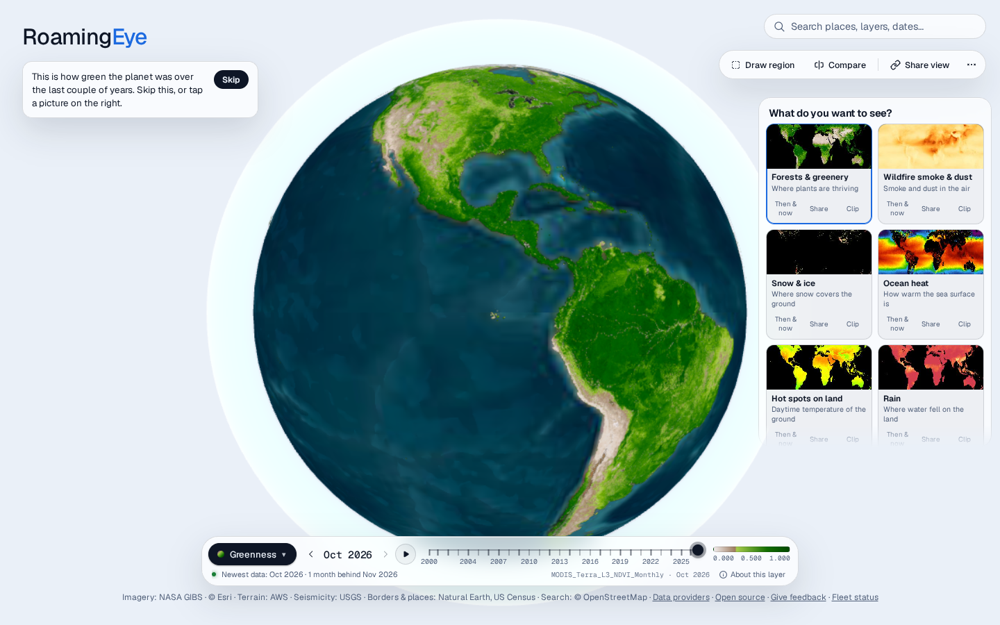
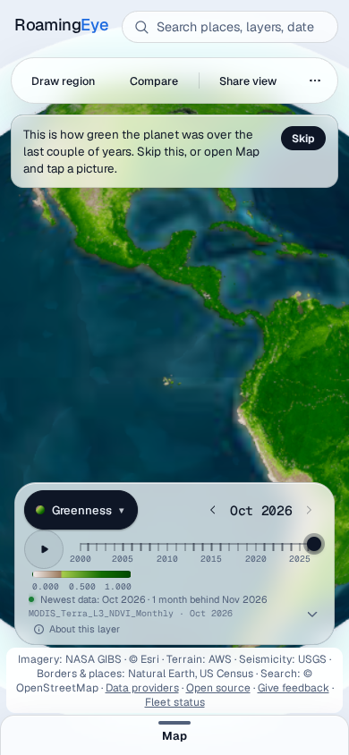
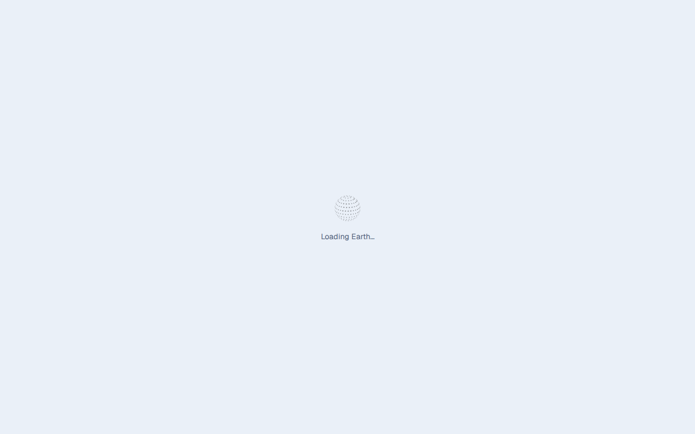
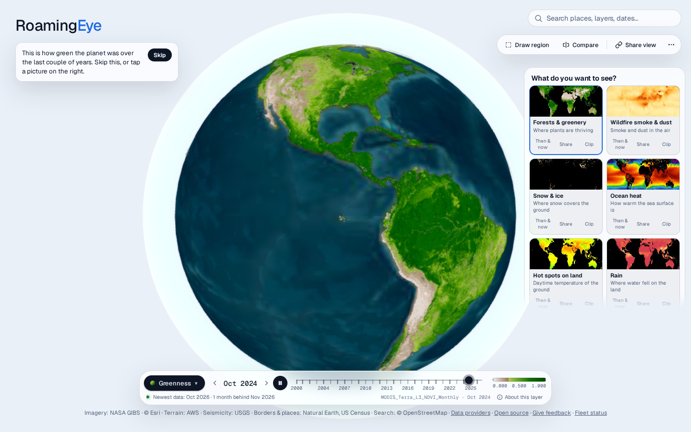
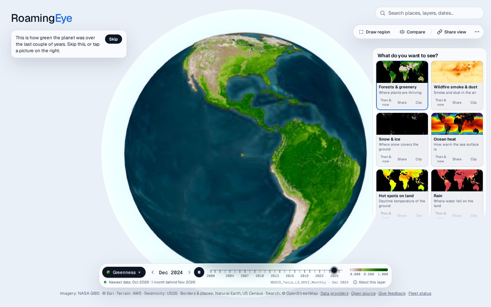
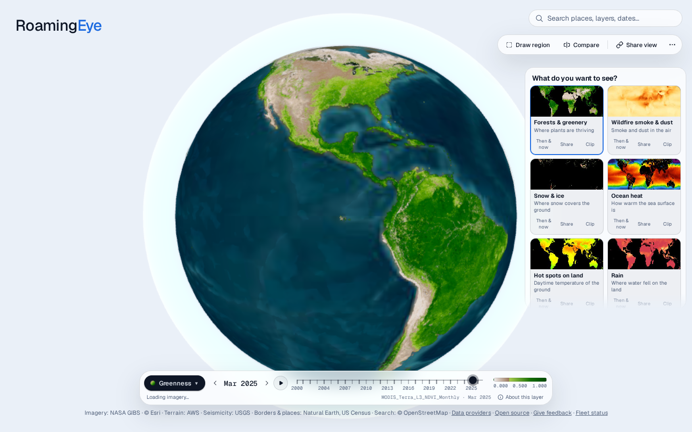

# Entry diet preview

Screenshots for the startup work. Desktop is 1440x900 and phone is 390x844.
Taken 2026-11-22 from a local production preview with software WebGL.

The first frame is the moment the loading curtain has lifted and the globe
is on screen. Tree-shaking three does not change that picture.

## Bundle check, before (main 0aaf810)

Eager JS is the entry chunk plus every modulepreload. That was 254.3 kB gzip.

```text
ok  index-DUcJDVPe.js: 58.4 kB gzip (budget 60 kB)
ok  three-C19eHO_A.js: 155.1 kB gzip (budget 170 kB)
ok  science-CW8BpuIh.js: 31.2 kB gzip (budget 60 kB)
ok  compare-CsfZLNOd.js: 2.7 kB gzip (budget 60 kB)
     total JS: 376.5 kB gzip
```

## Bundle check, after tree-shake

Eager JS is 241.7 kB gzip. GLTFLoader moved to `tiles-extras` (13.2 kB),
which is not modulepreloaded. One `three.js r187` engine stamp remains,
in the single `three-` chunk.

```text
ok  index-BfpfHLkA.js: 58.4 kB gzip (budget 60 kB)
ok  three-CF0q1FIn.js: 142.5 kB gzip (budget 148 kB)
ok  tiles-extras-CVTkomLU.js: 13.2 kB gzip (budget 60 kB)
ok  science-CW8BpuIh.js: 31.2 kB gzip (budget 60 kB)
ok  compare-CsfZLNOd.js: 2.7 kB gzip (budget 60 kB)
     total JS: 377.2 kB gzip
```

## First frame timings (one local run)

|                | Globe ready | Imagery curtain up |
| -------------- | ----------: | -----------------: |
| Desktop before |      579 ms |            2571 ms |
| Desktop after  |      542 ms |            2508 ms |
| Phone before   |      227 ms |            2118 ms |
| Phone after    |      202 ms |            2380 ms |

## First frame

Desktop before


Desktop after



Phone before


Phone after



## Opening seconds (desktop, before)

200 ms is the curtain. 600 ms is still the curtain. 1200 ms is the first
globe. 2500 ms and 5000 ms are the settled view.






