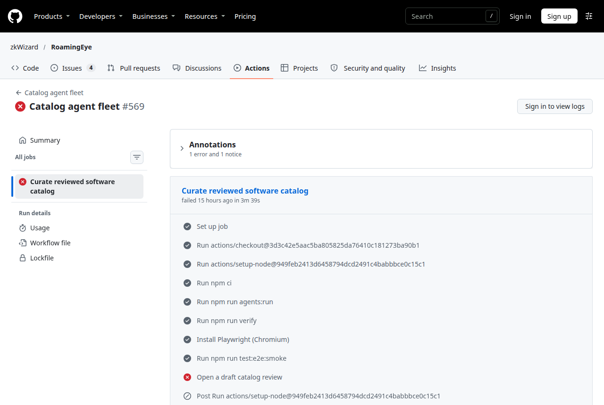
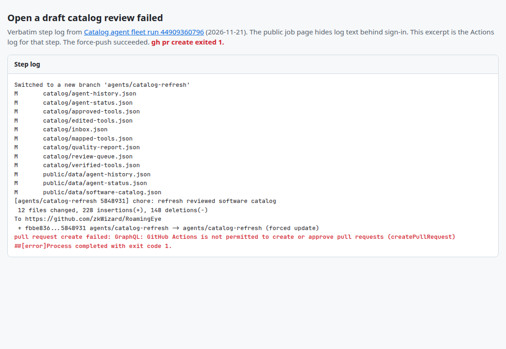
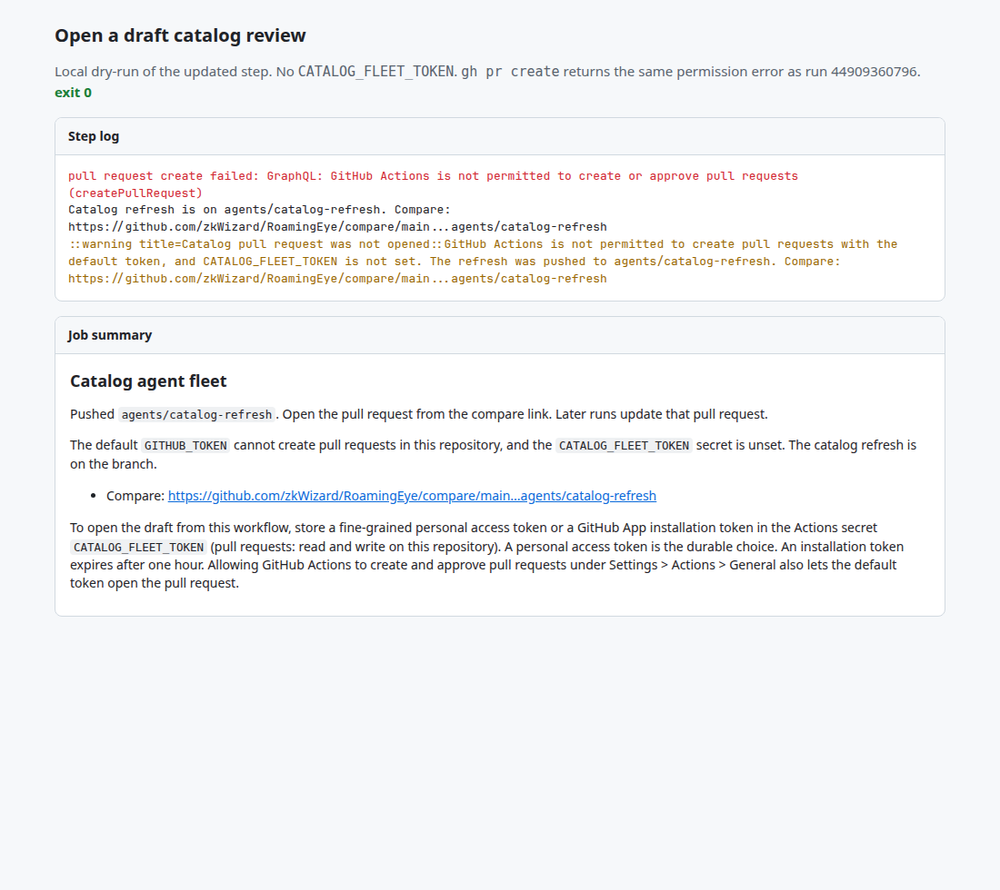

# Catalog fleet fix preview

Screenshots for the catalog agent fleet workflow change. Taken 2026-11-22.

`before-failed-step.png` is the public job page for
[run 44909360796](https://github.com/zkWizard/RoamingEye/actions/runs/44909360796)
(2026-11-21). Curate, verify, and the smoke tests passed. The red step is
"Open a draft catalog review". The public page hides the log text behind
sign-in.

`before-log-excerpt.png` is that step's log, copied from the Actions log for
the same run. The force-push of `agents/catalog-refresh` succeeded.
`gh pr create` then exited 1 with
`GitHub Actions is not permitted to create or approve pull requests`.

`after-dry-run-summary.png` is a local dry-run of the updated step with no
`CATALOG_FLEET_TOKEN`. `git` and `gh` are stubbed, and `gh pr create` returns
the same permission error. The step exits 0, emits a `::warning::`, and writes
this compare link to the job summary:

<https://github.com/zkWizard/RoamingEye/compare/main...agents/catalog-refresh>

