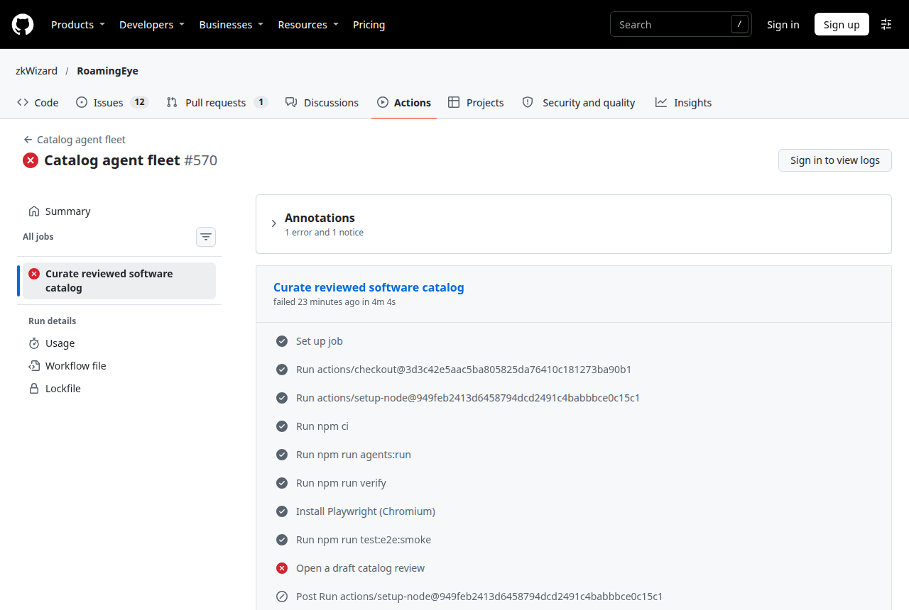
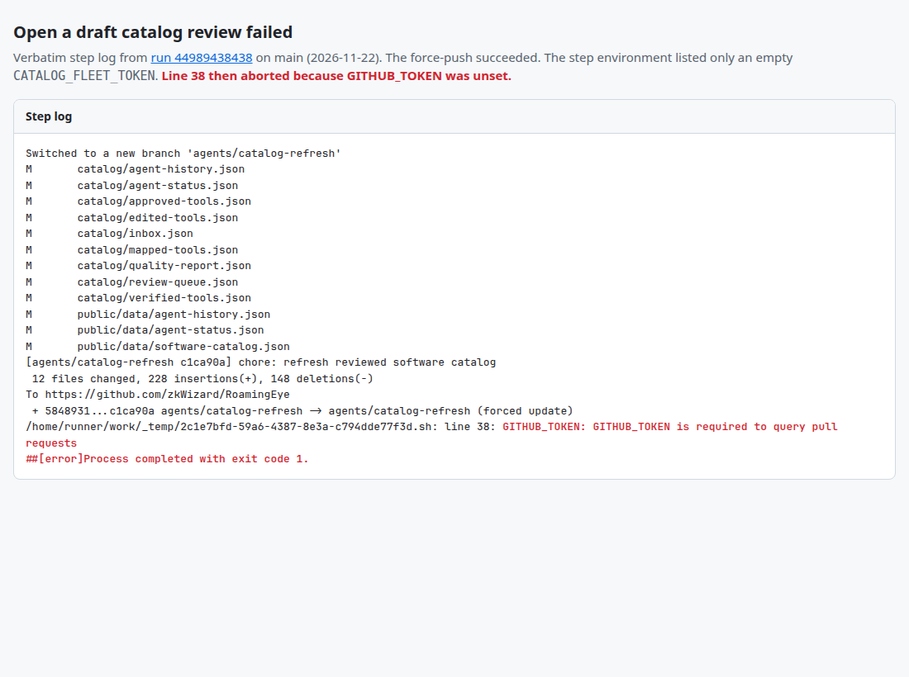

# Catalog fleet token preview

Screenshots for the follow-up that keeps a token available to `gh` in the
catalog fleet step. Taken 2026-11-22.

`before-missing-token-job.png` is the public job page for
[run 44989438438](https://github.com/zkWizard/RoamingEye/actions/runs/44989438438),
the post-merge dispatch on main. Curate, verify, and the smoke tests passed.
"Open a draft catalog review" failed. The public page hides log text behind
sign-in.

`before-missing-token-log.png` is that step's log. The force-push of
`agents/catalog-refresh` succeeded. The step environment listed only an empty
`CATALOG_FLEET_TOKEN`. Line 38 then aborted:
`GITHUB_TOKEN: GITHUB_TOKEN is required to query pull requests`.

`after-branch-dispatch.png` is a `workflow_dispatch` of this branch after the
fix. The same catalog changes are pushed, `gh` runs with the default token,
and the job finishes green. When GitHub still refuses pull request creation,
the step records a warning and the compare link instead of exiting 1.

