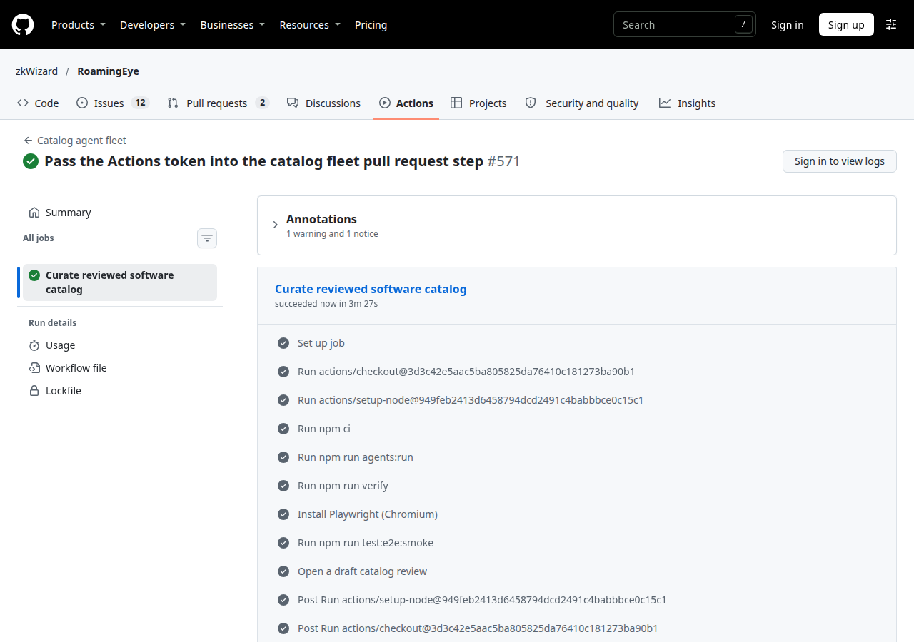
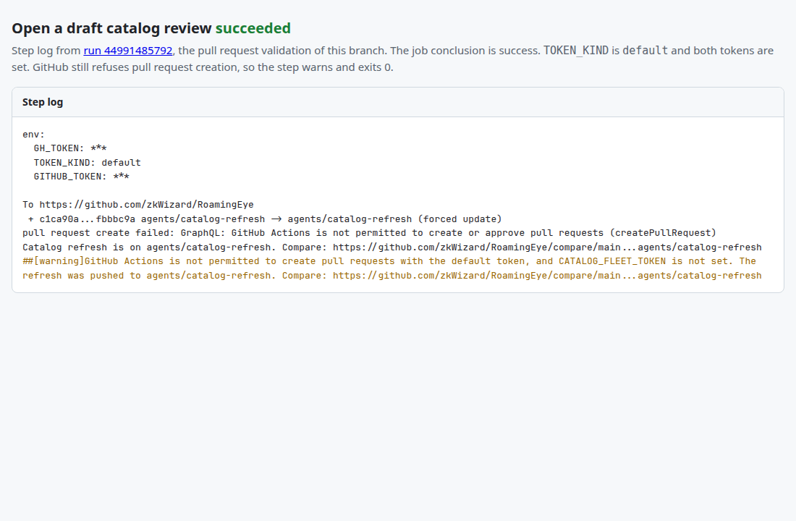

# Catalog fleet token preview

Screenshots for the follow-up that keeps a token available to `gh` in the
catalog fleet step. Taken 2026-11-22.

`before-missing-token-job.png` is the public job page for
[run 44989438438](https://github.com/zkWizard/RoamingEye/actions/runs/44989438438),
the post-merge dispatch on main. Curate, verify, and the smoke tests passed.
"Open a draft catalog review" failed. The public page hides log text behind
sign-in.

`before-missing-token-log.png` is that step's log. The force-push of
`agents/catalog-refresh` succeeded. The step environment listed only an empty
`CATALOG_FLEET_TOKEN`. Line 38 then aborted:
`GITHUB_TOKEN: GITHUB_TOKEN is required to query pull requests`.

`after-branch-dispatch.png` is
[run 44991485792](https://github.com/zkWizard/RoamingEye/actions/runs/44991485792),
a real Actions run of this branch. `workflow_dispatch` returned 403 for this
token, so the run was a pull request event. That trigger is not in the merged
workflow. The job succeeded in 3m 27s, including "Open a draft catalog review".

`after-branch-dispatch-log.png` is that step's log. `GH_TOKEN` and
`GITHUB_TOKEN` are both set, and `TOKEN_KIND` is `default`. The force-push
succeeded. `gh pr create` still gets the permission refusal, the step emits
a warning with the compare link, and the job exits 0.

